# Cohesity Architect Toolkit

[](CHANGELOG.md)
[](LICENSE)
[]()
[]()
[]()

> **Cohesity Architect Toolkit** — Sales Engineering Edition. Six steps. One customer profile. A complete, hardware-sized, compliance-mapped, priced proposal ready to hand over.
>
> Built for Cohesity Sales Engineers, Solutions Architects, and partner SEs who need to walk into a scoping call and leave with a defensible node count, a bandwidth plan, a compliance narrative, and a Bill of Materials — without opening a spreadsheet.

<p align="center">
  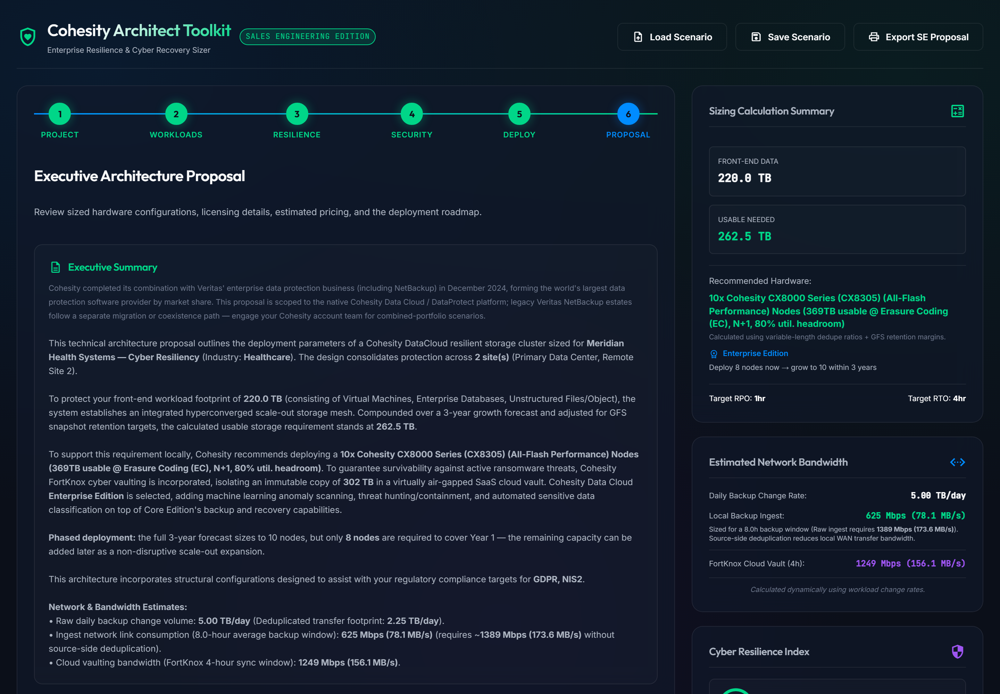
</p>
<p align="center"><sub>The Proposal step, generated live from a two-site, 220 TB healthcare scenario. Every number on this page — including the executive summary prose — is computed from the inputs on the previous five steps.</sub></p>

---

## Table of Contents

1. [Why This Tool](#1-why-this-tool)
2. [What It Delivers](#2-what-it-delivers)
3. [Use Cases](#3-use-cases)
4. [Getting Started](#4-getting-started)
5. [Wizard Step Guide](#5-wizard-step-guide)
6. [Sizing Methodology Reference](#6-sizing-methodology-reference)
7. [Bill of Materials & Pricing](#7-bill-of-materials--pricing)
8. [Compliance Framework Reference](#8-compliance-framework-reference)
9. [Security & Data Privacy](#9-security--data-privacy)
10. [Troubleshooting](#10-troubleshooting)
11. [Internal Architecture](#11-internal-architecture) *(Addendum — for developers)*
12. [Legal & Intellectual Property](#12-legal--intellectual-property)

---

## 1. Why This Tool

Cohesity's own sizing tools and SE resources are excellent for validating a final configuration. This toolkit fills the gap that comes *before* that — the first customer call, where you need a defensible ballpark (node count, bandwidth, an annual number, a compliance story) in minutes, not after a follow-up email to your SE team.

### What a blank sizing spreadsheet gives you

- A place to type in TB figures and multiply by a dedupe ratio you remember from the last deal
- No compliance framework mapping — that's a separate conversation with legal/security
- No bandwidth math — WAN sizing gets guessed or skipped until it becomes a deployment surprise
- No proposal document — someone still has to write the executive summary by hand
- No firewall/port reference — that's a separate doc you dig up per engagement

### What this tool adds on top

| Gap in a manual spreadsheet | What the Architect Toolkit does |
|---|---|
| **No compliance-to-architecture mapping** — you know GDPR matters, but not which specific Cohesity feature satisfies which article | **Eight compliance frameworks** (GDPR, HIPAA, PCI-DSS v4.0, NIS2, DORA, FedRAMP, SOC 2, CCPA/CPRA) mapped clause-by-clause to the specific Cohesity capability that satisfies it, with official regulator + Cohesity solution-brief links |
| **Bandwidth is an afterthought** — sizing tools give you capacity, not the WAN link you need | **Live bandwidth model** — daily change rate, raw vs. deduplicated ingest, replication link, and FortKnox vault sync, all driven by each workload's own backup window and dedupe ratio |
| **Node sizing is a guess** — "probably 4 or 5 nodes" | **N+1 cluster math against real hardware families** — CX8000 (all-flash), C6200 (hybrid), C5200 (entry/ROBO) — with the family's own minimum node count and usable capacity, not a flat guess |
| **Multi-site scoping means multiple spreadsheets** | **Native multi-site model** — add, rename, and remove sites; each with its own workload mix; sizing, bandwidth, and the topology diagram all roll up automatically |
| **No architecture diagram** until someone opens Visio | **Interactive SVG topology diagram** — sites, cluster, FortKnox vault, and replication target, regenerated live as you configure the wizard, with click-through detail on every node |
| **Firewall requirements are a separate lookup** | **Dynamic port table** — only the ports your actual configuration needs, with source/destination/purpose, ready to hand to a network team |
| **The proposal document is written from scratch every time** | **Generated executive summary, BOM, deployment roadmap, and compliance appendix** — copy as text or export a print-ready PDF in one click |
| **Pricing conversations start from zero** | **Editable pricing model** — illustrative default rates you overwrite with your own negotiated numbers; every BOM line recalculates instantly |

### Where this tool is most effective

1. **First scoping call** — walk through six steps live on a screen-share and leave with a real number
2. **Deal-desk prep** — a defensible node count and BOM before escalating to a formal Cohesity SE sizing
3. **Compliance-led conversations** — when the buyer's first question is "how does this satisfy DORA," not "how many TB"
4. **Multi-site / DR conversations** — sizing a primary + DR site together instead of two disconnected spreadsheets
5. **Internal enablement** — a fast, consistent way for less experienced SEs to produce a defensible first-pass sizing

---

## 2. What It Delivers

In one pass through the six-step wizard, the tool produces a complete, internally consistent sizing package — nothing is looked up twice, and every downstream number (BOM, bandwidth, proposal text) recalculates the instant you change an input upstream.

**Computed from your inputs:**
- Front-end and usable-TB sizing per workload, compounded over a 3-year growth forecast and adjusted for GFS retention overhead
- A recommended node count and hardware family, sized **N+1** against Cohesity's real resiliency model — **RF2 (~50% usable) below 6 nodes, Erasure Coding (~80% usable) at 6+**, with an 80% operational-utilization headroom target, and a throughput check that bumps node count when aggregate ingest bandwidth (not just capacity) demands it
- A **phased-expansion checkpoint** — a Year-1 node count alongside the full 3-year figure, so a deal doesn't have to be sized (or priced) for growth that hasn't happened yet
- Daily backup change volume, raw and deduplicated ingest bandwidth, replication bandwidth, and FortKnox vault sync bandwidth — each tied to its own workload's backup window
- A 0–100 Cyber Resilience Index scoring immutability, MFA/MPA, vaulting, and malware scanning, with the specific gaps that are dragging the score down
- An **edition-aware Bill of Materials** (Core vs. Enterprise Edition) with per-line and total annual pricing, driven by an editable rate table
- A **Consolidation Value / TCO estimate** translating the blended dedupe/compression ratio into an illustrative avoided-storage-cost figure
- An interactive topology diagram reflecting your actual site count, replication mode, and security posture — exportable standalone as SVG

**Reference content built in:**
- Six Cohesity product profiles (DataProtect, Alta, FortKnox, Threat Defense/Enterprise Edition, SmartFiles, SiteContinuity, Gaia) with taglines, feature lists, and licensing models
- Three physical hardware families (CX8000 all-flash, C6200 hybrid, C5200 entry/ROBO) with real current-generation SKU ranges
- Eight compliance frameworks with clause-level architecture mappings and official reference links
- Four integration playbooks (Splunk SIEM, ServiceNow REST, SiteContinuity DR runbook YAML, Ansible bootstrap) with values auto-substituted from your project
- A dynamic firewall/TCP port reference, filtered to what your configuration actually requires, plus **cluster-internal network prerequisites** (IPMI, node VIPs, L2/LACP/jumbo frames) that a port table alone doesn't cover
- **Competitive positioning notes** (vs. Veeam, Rubrik, Commvault, legacy NetBackup estates) and a downloadable **As-Built/handover document** capturing the exact configuration a proposal was sized against

**Save your work:** the full scenario (every input across all six steps) can be exported to a JSON file and reloaded later — from the header's **Save Scenario** / **Load Scenario** buttons. Nothing persists automatically; this is the explicit save/share mechanism.

---

## 3. Use Cases

### First Scoping Call

**Goal:** Leave a discovery call with a real node count and rough annual number, not "let me get back to you."

**Workflow:**
1. **Project** — name the opportunity, pick the industry vertical, check the compliance boxes the customer mentioned
2. **Workloads** — enter each workload's front-end TB, growth rate, and backup window as the customer describes them
3. **Deploy** — pick a hardware tier (or leave the default; database-heavy workloads auto-upgrade to all-flash)
4. **Proposal** — the sidebar already shows node count and usable TB after step 2; click through to Proposal for the full narrative and BOM

**Output:** A defensible hardware recommendation and estimated annual cost, generated live while still on the call.

---

### Compliance-Led Conversation

**Goal:** When the buyer's opening question is about DORA or FedRAMP, not TB.

**Workflow:**
1. Go to **Project** and check the relevant compliance directive(s) — this auto-applies the architectural defaults that framework requires (e.g. DORA turns on FortKnox and SiteContinuity; FedRAMP forces customer-managed KMS)
2. Go to **Proposal** and scroll to **Regulatory Compliance & Data Governance Mapping** — every checked framework gets its own card with clause-by-clause "how it's satisfied" text and official reference links

**Output:** A compliance narrative mapped to specific Cohesity capabilities, with citations, ready to drop into a security questionnaire response.

---

### Multi-Site / DR Sizing

**Goal:** Size a primary data center and a DR site together, with one consistent BOM and topology diagram.

**Workflow:**
1. Go to **Workloads** → click **Add Site**, rename it (e.g. "DR — Denver"), and configure its own workload mix
2. Go to **Resilience** and set the replication target (second site, Cloud Edition, or FortKnox SaaS vault)
3. The sidebar's Front-End Data and Usable Needed figures roll up across every site automatically
4. Scroll to the **Interactive Architectural Topology Diagram** at the bottom of any step to see both sites, the cluster, and the replication target rendered live

**Output:** A single sizing and BOM that covers the full multi-site footprint, with a topology diagram to match.

---

### Ransomware / Cyber Resilience Conversation

**Goal:** Show a customer exactly what their current posture scores, and what closes the gap.

**Workflow:**
1. Go to **Security** and toggle FortKnox, Threat Defense & Data Classification, MFA, MPA, and KMS to match (or propose) the customer's posture
2. The sidebar's **Cyber Resilience Index** updates live (0–100) with a color-coded rating
3. Go to **Proposal** → the print/PDF export includes a **Resiliency Gap Analysis** listing exactly which controls are off and what they cost the score

**Output:** A quantified before/after resilience score tied to specific, named Cohesity controls.

---

### Deployment Handoff to a Network/Implementation Team

**Goal:** Give an implementation engineer the exact firewall rules and integration snippets for this specific configuration — not a generic port list.

**Workflow:**
1. Configure the wizard fully (workloads, replication mode, FortKnox on/off)
2. Scroll to **Enterprise Integration Snippets & Playbooks** at the bottom of any step
3. Click the **Firewall / TCP Ports** tab — the table shows only the ports your configuration actually needs, each marked ACTIVE or INACTIVE
4. Click through **Splunk SIEM Webhook**, **ServiceNow REST Script**, **SiteContinuity Runbook**, or **Ansible Playbook** for ready-to-edit snippets with your project's name, cluster FQDN, and workload names already substituted in

**Output:** A configuration-specific firewall table and a set of starter integration scripts, not a generic reference doc.

---

## 4. Getting Started

### Prerequisites

| Requirement | Minimum | Notes |
|---|---|---|
| **A modern browser** | Any current Chrome/Edge/Firefox/Safari | Pure client-side JS — no server-side rendering |
| **Python** (optional) | 3.x | Only needed to serve the files over `http://` instead of opening `index.html` directly — recommended so the pricing fetch works |

> **No npm, no build step, no package manager.** `app.js` and `data.js` are hand-authored, unminified, plain JavaScript. Edit and refresh.

### Step 1 — Clone the Repository

```bash
git clone https://github.com/ebeauzec/CohesityDesigner.git
cd CohesityDesigner
```

### Step 2 — Serve It Locally

| Method | How | Notes |
|---|---|---|
| **Python HTTP server** ⭐ | `python -m http.server 8893` then open `http://localhost:8893` | **Recommended.** Needed for the `fetch('pricing.json')` call in `init()` to succeed (fails under `file://`) |
| **Any static file server** | `npx serve .`, `php -S localhost:8893`, an IDE's built-in preview, etc. | Works identically — it's a static site |
| **Directly opening `index.html`** | Double-click the file | Works, but the pricing panel falls back to built-in defaults since `fetch()` can't load `pricing.json` over `file://` |

### Step 3 — Work Through the Wizard

Open the served URL and step through **Project → Workloads → Resilience → Security → Deploy → Proposal**. Every field updates the sidebar's Sizing Calculation Summary, Estimated Network Bandwidth, and Cyber Resilience Index live — you don't need to reach the Proposal step to see the numbers change.

### Step 4 — Save Your Work / Export

Nothing auto-saves. From the **header**: **Save Scenario** downloads the entire wizard state as a JSON file; **Load Scenario** reopens one later (yours or a colleague's) and re-populates every field. From the **Proposal** step: **Copy Proposal Text** puts a full plain-text version on your clipboard; **Download As-Built Doc** exports a technical configuration record for implementation handover; **Download Proposal PDF** (or the header's **Export SE Proposal** button) opens the browser's print dialog against a dedicated print layout — save as PDF from there.

---

## 5. Wizard Step Guide

### Step 1 — Project

Customer project name, industry vertical (drives default growth/retention assumptions), and compliance directive checkboxes. Checking a framework here auto-applies the architectural defaults it requires — e.g. checking **DORA** silently turns on FortKnox and SiteContinuity if they weren't already on, and checking **FedRAMP** forces the KMS selector to Customer-Managed.

<p align="center">
  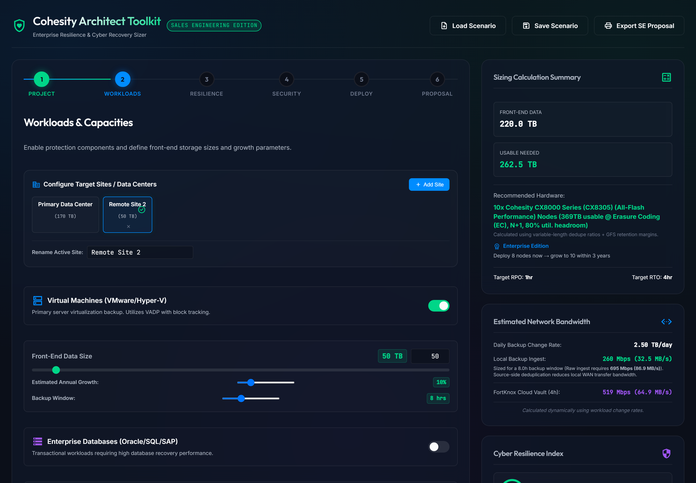
</p>

### Step 2 — Workloads

Add, rename, and remove sites from the **Configure Target Sites / Data Centers** panel — each site carries its own independent set of five workload toggles (VMs, Databases, Files/Object, SaaS, Kubernetes), each with its own front-end TB size, annual growth rate, and backup window slider.

<p align="center">
  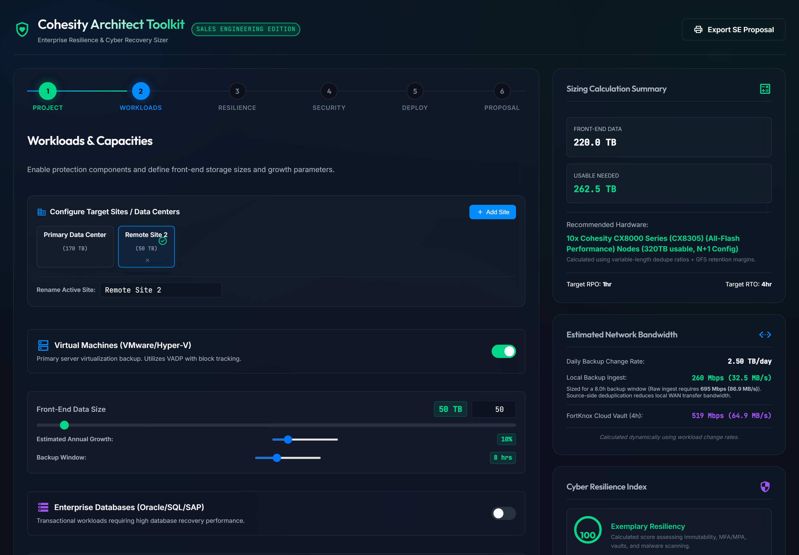
</p>

### Step 3 — Resilience

Target RPO/RTO selection, replication mode (none / second site / Cloud Edition / FortKnox SaaS vault), and the SiteContinuity DR orchestrator toggle. The sidebar's bandwidth panel breaks out daily change rate, ingest bandwidth (raw and deduplicated), replication bandwidth, and FortKnox vault sync bandwidth — each computed from the actual per-workload backup windows set in Step 2.

<p align="center">
  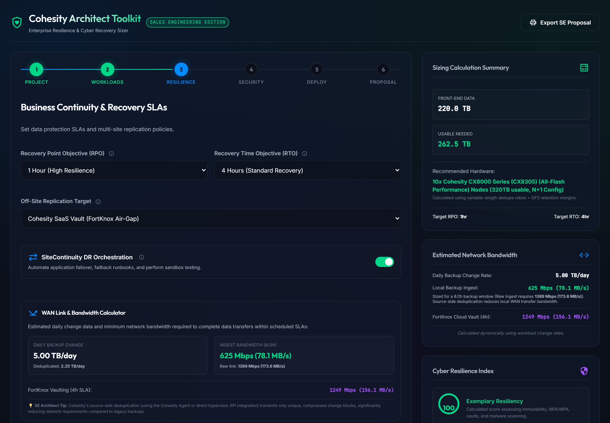
</p>

### Step 4 — Security

FortKnox cyber vaulting, Threat Defense & Data Classification (which also switches the BOM between Core and Enterprise Edition pricing — see [Section 7](#7-bill-of-materials--pricing)), Helios MFA, Quorum MPA, and the encryption KMS selector (Cohesity-managed vs. customer-managed). Every toggle here feeds the Cyber Resilience Index and the Hardening Checklist in the sidebar in real time.

<p align="center">
  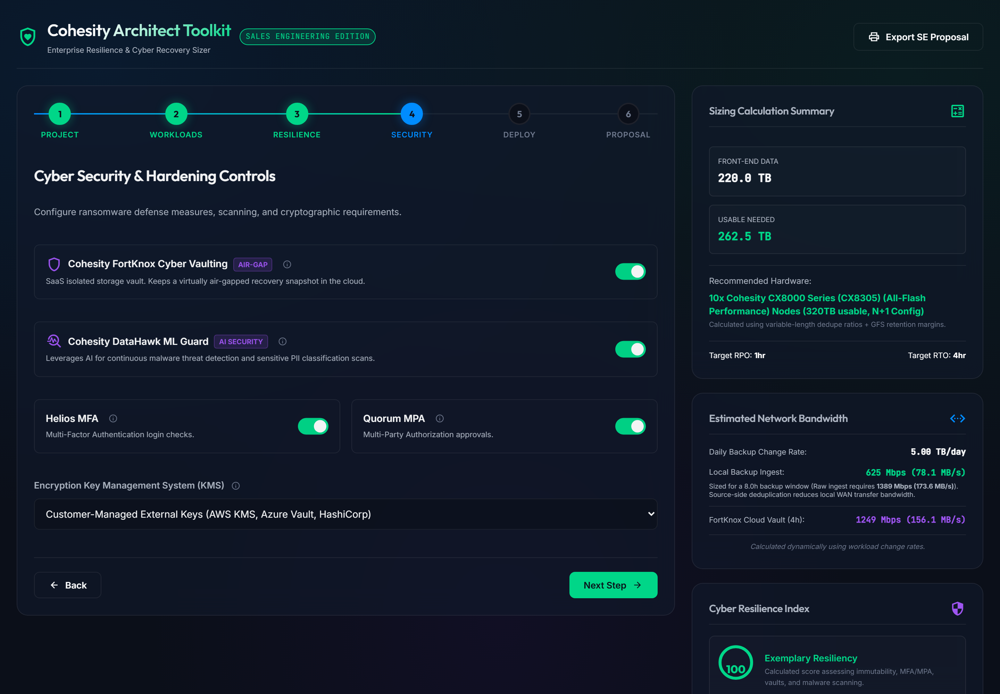
</p>

### Step 5 — Deploy

Deployment model (on-prem / SaaS / hybrid) and the physical hardware class preference — **Performance All-Flash NVMe (CX8000 Class)**, **Capacity Standard Hybrid (C6200 Class)**, or **Entry-Level / ROBO Hybrid (C5200 Class)**. Database-heavy workloads (over 35% of front-end footprint) automatically upgrade to the all-flash tier regardless of this selection, since that's what Cohesity would actually recommend for that mix.

<p align="center">
  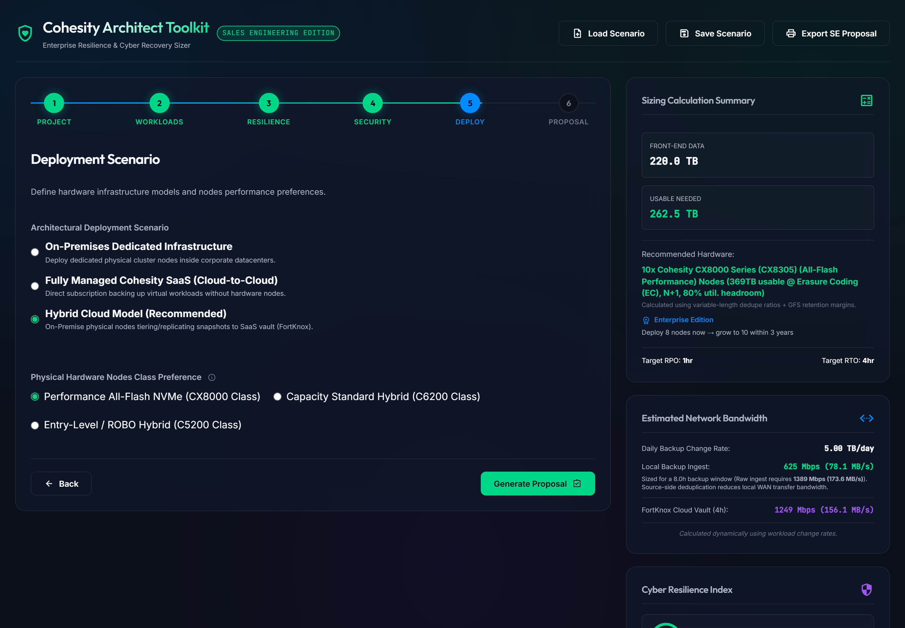
</p>

### Step 6 — Proposal

The complete output: an auto-generated executive summary, an editable pricing panel, a full Bill of Materials with line-item and total annual pricing, a Consolidation Value/TCO estimate, the regulatory compliance mapping for every framework checked in Step 1, competitive positioning notes, a four-phase deployment roadmap, and the export actions (proposal text, PDF, and As-Built handover document).

<p align="center">
  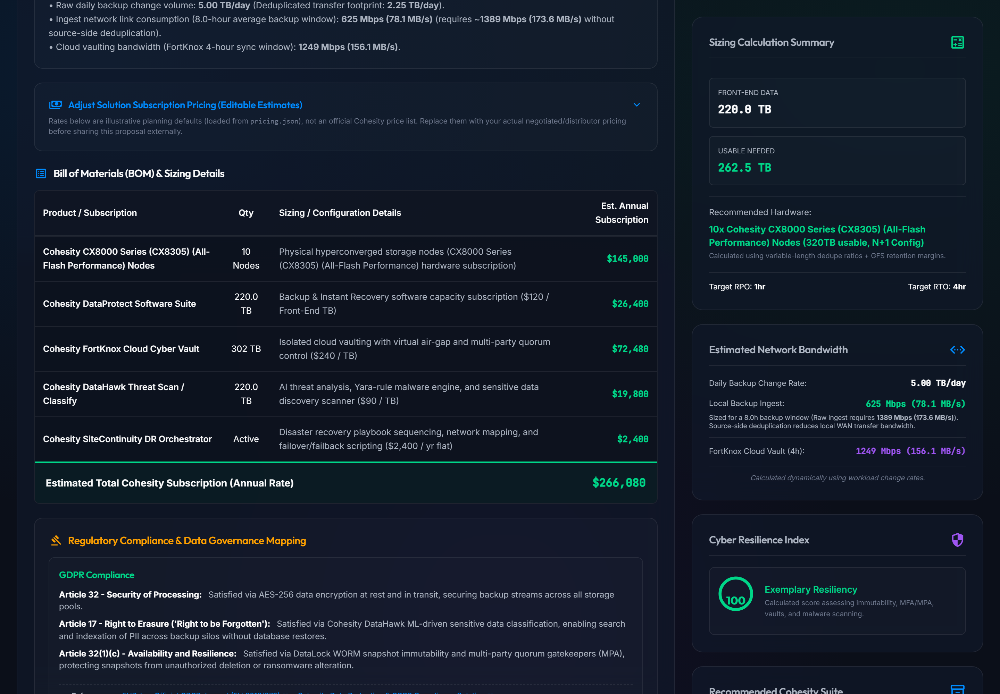
</p>

<p align="center">
  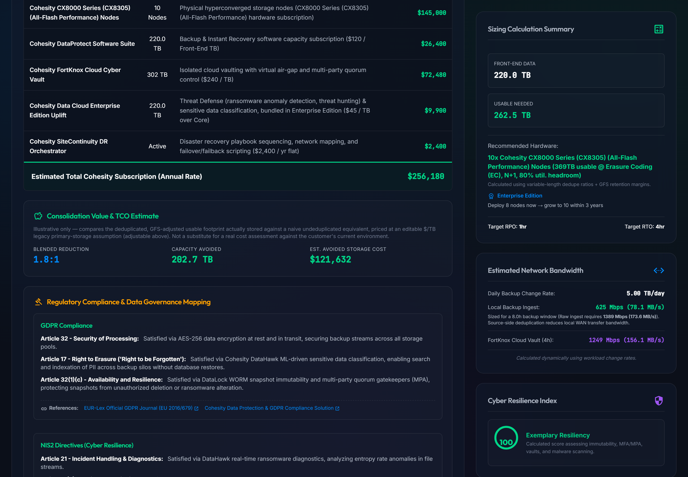
</p>

<p align="center">
  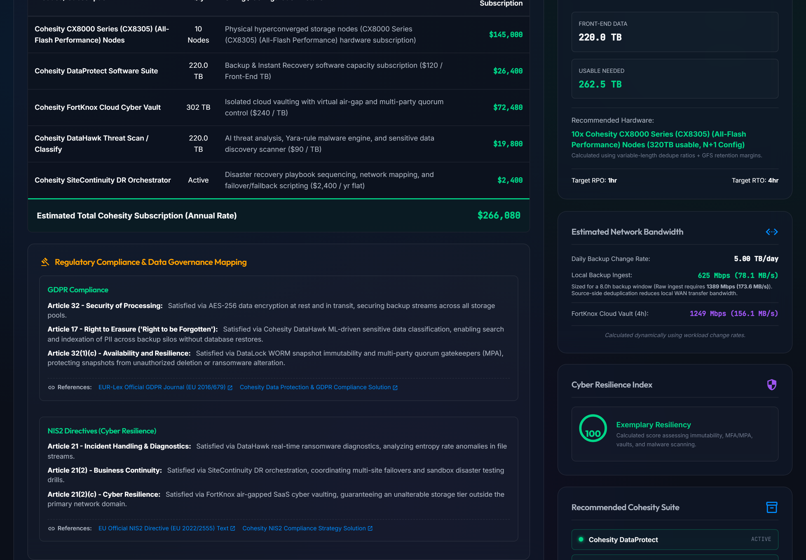
</p>

<p align="center">
  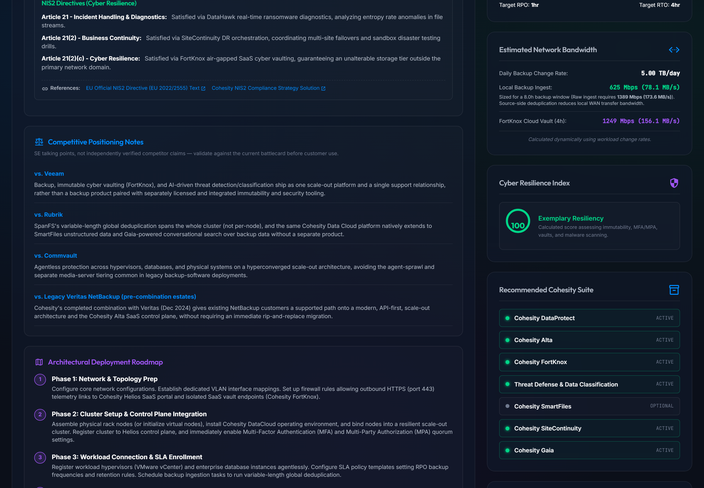
</p>

### Persistent: Topology Diagram & Integration Playbooks

Below the wizard on every step: an interactive SVG topology diagram (click any node for detail, or use the **SVG** button to export it standalone) and a tabbed panel of integration snippets — Splunk, ServiceNow, SiteContinuity runbook YAML, Ansible, and a dynamic firewall/port table.

<p align="center">
  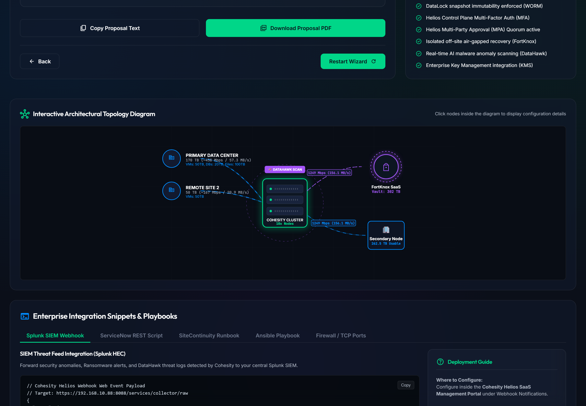
</p>

<p align="center">
  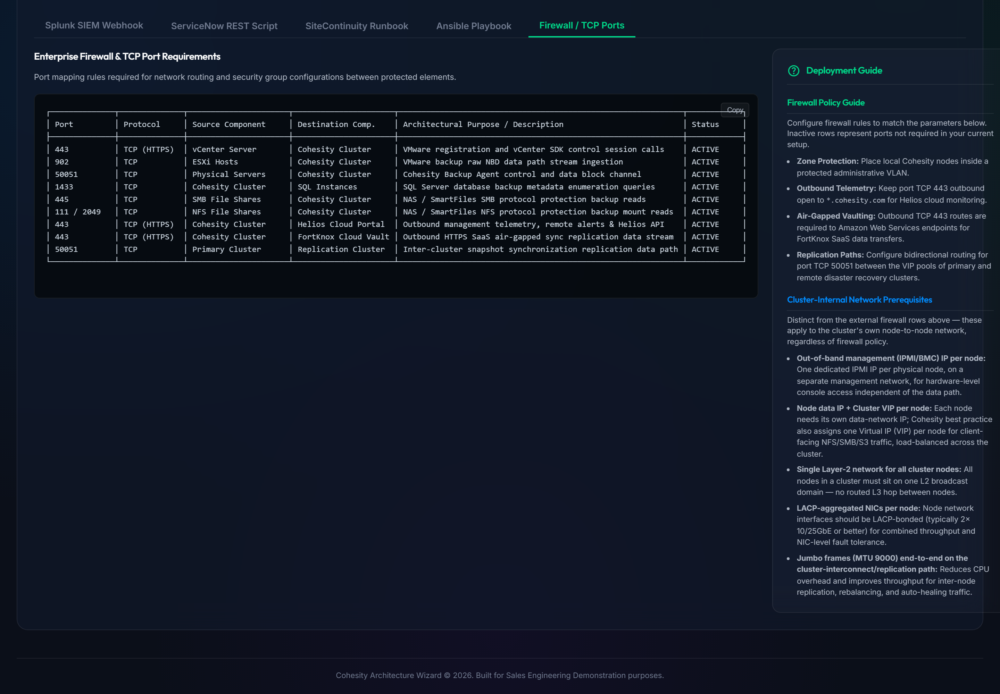
</p>

---

## 6. Sizing Methodology Reference

> This section documents exactly how the numbers on screen are calculated, so an SE can defend them in front of a customer. All formulas live in `calculateSizing()` and `calculateBandwidth()` in `app.js`.

### Usable Capacity Formula

For each active workload, per site:

```
compoundedCapacity = frontEndTB × (1 + growthRate)³           # 3-year compound growth
deduplicatedCapacity = compoundedCapacity / dedupeRatio         # workload-preset dedupe ratio
usableTB = deduplicatedCapacity × retentionMultiplier           # GFS retention overhead
```

**Retention multipliers** (fixed per workload type, reflecting typical GFS snapshot schedules):

| Workload | Retention Multiplier | Default Dedupe Ratio | Default Daily Change |
|---|---|---|---|
| Virtual Machines | 1.35 | 2.5:1 | 3% |
| Enterprise Databases | 1.15 | 3.0:1 | 5% |
| Unstructured Files/Object | 1.45 | 1.4:1 | 1% |
| SaaS (M365/Salesforce) | 1.85 | 2.0:1 | 1% |
| Kubernetes | 1.25 | 2.0:1 | 4% |

Total usable TB is the sum across every active workload on every configured site. If the replication mode is **second site** or **Cloud Edition**, total system usable TB doubles (a full 1:1 replica copy); a **FortKnox SaaS vault** does not double local primary sizing, since it's a separate vaulted copy, not a mirrored primary.

### Node Hardware Reference

| Family | Representative SKU | Tier | Raw Capacity/Node | Min Nodes | Est. Throughput/Node | Real SKU Range |
|---|---|---|---|---|---|---|
| **CX8000 Series** | CX8305 | All-Flash Performance | 46.08 TB | 4 (sold in blocks) | ~800 MB/s | CX8205 (23.04TB) / CX8305 (46.08TB) / CX8405 (92.16TB) raw NVMe |
| **C6200 Series** | C6216S | Hybrid Standard | 204.8 TB | 3 | ~500 MB/s | C6208S (96TB) / C6216S (192TB) / C6224 (288TB) raw HDD + 6.4–12.8TB PCIe flash |
| **C5200 Series** | C5224 | Entry-Level Hybrid | 75.2 TB | 3 | ~300 MB/s | C5204 through C5224 (12–72TB raw HDD) + 1.6–3.2TB PCIe flash |

> Raw capacities are per Cohesity's public datasheets. Throughput figures are SE planning estimates, not a published per-node spec — used only to flag when a configuration is throughput-bound. Each family ships multiple capacity points; the wizard sizes against one representative mid-tier SKU per family. **Always confirm the exact SKU, usable capacity, and throughput with Cohesity or a Cohesity partner before quoting** — see `data.js`'s `nodeTypes.physical` for the full source data.

#### Resiliency model: RF2 vs. Erasure Coding

Usable capacity is **not** a flat ratio of raw — it depends on cluster size, per Cohesity's own Fault Tolerance white paper:

| Mode | When | Usable Ratio |
|---|---|---|
| **RF2** (Replication Factor 2) | Below 6 nodes | ~50% of raw |
| **Erasure Coding (EC)** | 6+ nodes | ~80% of raw |

`sizeNodesForCapacity()` in `app.js` iterates candidate node counts, switching ratio automatically at the 6-node threshold, and stops once the cluster **minus one node** (N+1) still covers the requirement — so the resiliency mode, not just the node count, can change based on how much capacity is needed.

```
target = neededUsableTB / utilizationHeadroom        # headroom = 0.80 (SE guideline, not an official Cohesity number)
usableRatio = (nodeCount >= 6) ? 0.80 : 0.50           # EC vs RF2
usablePerNode = capacityRawTB × usableRatio
# increment nodeCount until: (nodeCount - 1) × usablePerNode >= target
```

**Throughput check:** after capacity sizing, the required raw ingest rate (from the bandwidth formulas below) is compared against `(nodeCount - 1) × estThroughputMBps`. If capacity-driven sizing wouldn't carry enough ingest bandwidth, node count is bumped further and the recommendation is labeled "sized for ingest throughput" rather than pure capacity.

**Phased expansion:** the same function is also run against a Year-1-only projection (growth compounded to the power of 1, not 3), producing a `year1NodeCount` shown alongside the full 3-year figure whenever they differ — e.g. "Deploy 8 nodes now → grow to 10 within 3 years."

A workload mix where database capacity exceeds 35% of total front-end footprint automatically sizes against the CX8000 (all-flash) tier regardless of the Deploy step's selection, since that's the performance profile Cohesity would actually recommend for a database-heavy estate.

### FortKnox Vault Sizing

```
fortKnoxVaultTB = ceil(usableLocalTB × 1.15)
```

FortKnox stores an already-deduplicated, immutable copy, so it's sized off the local usable footprint (already dedup- and retention-adjusted) rather than raw front-end capacity, plus a 15% buffer for the vault's typically longer immutable retention window.

### Bandwidth Formulas

For each active workload:

```
dailyChangeRawTB = frontEndTB × dailyChangeRate                 # workload-preset % (see table above)
dailyChangeDedupeTB = dailyChangeRawTB / dedupeRatio
ingestMbps = (dailyChangeDedupeTB × 8,000,000) / (backupWindowHours × 3600)
```

Raw and deduplicated ingest bandwidth are summed across every active workload and site. Replication bandwidth (site-to-site or Cloud Edition) and FortKnox vault sync bandwidth are each computed against a fixed 4-hour sync/replication window. MB/s figures are Mbps ÷ 8 throughout, shown alongside Mbps everywhere bandwidth is displayed.

### Cyber Resilience Index

Starts at 100, with fixed deductions for each missing control:

| Missing Control | Deduction |
|---|---|
| No off-site replication configured | −20 |
| FortKnox cyber vault not enabled | −25 |
| Threat Defense/data classification not enabled (Enterprise Edition) | −20 |
| Helios MFA not enabled | −15 |
| Multi-Party Approval (MPA) not enabled | −15 |
| Cohesity-managed (not customer-managed) KMS | −10 |
| 15-minute RPO target without SiteContinuity | −10 |
| No workloads selected for protection | Score forced to 0 |

Floored at 10 (never shown as a bare 0 unless no workloads are protected at all). ≥80 is rated "Exemplary Resiliency" (green), ≥50 is "Vulnerable Cyber Defense" (amber), below 50 is "Critical Resiliency Risk" (red).

### Consolidation Value / TCO Estimate

```
spaceSavedTB = rawUndupedTB - usableLocalTB     # naive undeduplicated equivalent minus what's actually stored
avoidedCostUSD = spaceSavedTB × primaryStorageCostPerTB
blendedReduction = rawUndupedTB / usableLocalTB
```

`rawUndupedTB` is accumulated alongside the usable-capacity calculation in `calculateSizing()` — the same per-workload growth and retention multipliers, just without dividing by the dedupe ratio. `primaryStorageCostPerTB` is an editable illustrative rate (default $600/TB) representing legacy primary-storage cost avoided by consolidating onto Cohesity's global variable-length deduplication. This is explicitly labeled as illustrative in the UI and export — it is not a substitute for a real cost assessment against a customer's actual current spend.

### Cluster-Internal Network Prerequisites

Distinct from the external firewall port table (`getNetworkPorts()`), sourced from Cohesity's "Optimal Network Designs" reference architecture and shown in the Firewall/TCP Ports tab, the print export, and the As-Built document:

| Requirement | Why |
|---|---|
| Out-of-band management (IPMI/BMC) IP per node | Hardware-level console access independent of the data path |
| Node data IP + Cluster VIP per node | One VIP per node for client-facing NFS/SMB/S3 traffic, load-balanced across the cluster |
| Single Layer-2 network for all cluster nodes | No routed L3 hop between nodes |
| LACP-aggregated NICs per node | Combined throughput and NIC-level fault tolerance (typically 2× 10/25GbE+) |
| Jumbo frames (MTU 9000) end-to-end on the cluster-interconnect/replication path | Reduces CPU overhead, improves inter-node replication/rebalancing throughput |

---

## 7. Bill of Materials & Pricing

The BOM is generated line-by-line from the same sizing engine described above — physical nodes (or SaaS capacity), Core Edition DataProtect software, an Enterprise Edition uplift (when Threat Defense/Data Classification is enabled on the Security step), FortKnox vault, SiteContinuity, and (when Cloud Edition replication is selected) cloud virtual nodes.

> [!IMPORTANT]
> **The default rates are illustrative planning estimates, not an official Cohesity price list.** They ship in [`pricing.json`](pricing.json) and are clearly labeled "(Editable Estimates)" in the UI. Cohesity does not publish public list pricing — replace every rate with your own negotiated or distributor pricing under **Proposal → Adjust Solution Subscription Pricing** before sharing a proposal externally. Every BOM line and the executive summary total recalculate the instant you change a rate.

| Rate | Default (illustrative) | Applies To |
|---|---|---|
| `saasTB` | $200 / TB / yr | Cohesity DataProtect SaaS (when Deploy model = SaaS) |
| `physicalNode` | $14,500 / node / yr | Physical hardware node subscription, any of the three families |
| `dataprotectTB` | $120 / TB / yr | Core Edition DataProtect software capacity license |
| `cloudNode` | $9,800 / node / yr | Cloud Edition IaaS virtual nodes (replication target) |
| `fortknoxTB` | $240 / TB / yr | FortKnox vaulted capacity |
| `enterpriseUpliftTB` | $45 / TB / yr | Enterprise Edition uplift over Core (Threat Defense, data classification — see [Section 12](#12-legal--intellectual-property) note on DataHawk) |
| `sitecontinuityFlat` | $2,400 / yr flat | SiteContinuity DR orchestrator |
| `primaryStorageCostPerTB` | $600 / TB | Legacy primary-storage cost assumption, used only for the TCO estimate |

> **On the "DataHawk" line disappearing:** earlier versions of this tool billed DataHawk as its own per-TB SKU. As of Cohesity's current Data Cloud packaging, those capabilities (threat detection, classification) ship as part of Enterprise Edition rather than a standalone product — see the `datahawk` entry in `data.js`'s `products` array and [CHANGELOG.md v3.0.0](CHANGELOG.md#300---2026-09-25) for the research behind this change. Confirm current SKU boundaries with your Cohesity account team before quoting, since public packaging pages can lag the live price book.

---

## 8. Compliance Framework Reference

Each framework below is available as a checkbox on the **Project** step. Checking one both applies architectural defaults (see [Wizard Step Guide](#step-1--project)) and adds a clause-mapped card to the Proposal step's compliance section, complete with official regulator and Cohesity solution-brief links.

| Framework | Scope | Key Architectural Mapping |
|---|---|---|
| **GDPR** | EU data privacy | AES-256 encryption, DataHawk PII discovery (Right to Erasure), DataLock + MPA (availability/resilience) |
| **HIPAA Security Rule** | US healthcare | KMS-integrated encryption, Helios audit logging, DataHawk anomaly detection, FortKnox off-site vaulting |
| **PCI-DSS v4.0** | Payment card data | Encrypted vaults, MPA quorum on deletion, DataHawk threat scanning, continuous compliance validation |
| **NIS2** | EU cyber resilience directive | DataHawk behavioral analytics, SiteContinuity DR testing, FortKnox air-gapped vaulting |
| **DORA** | EU financial operational resilience | SiteContinuity resilience testing, CDP journaling for near-zero RPO, FortKnox third-party isolation |
| **FedRAMP** | US federal | FIPS 140-3 validated encryption (140-2 sunset Sept 21, 2026), FortKnox GovCloud, MPA quorum — see note below |
| **SOC 2 Type II** | Trust services audit | Helios MFA, immutable audit logs, DataLock WORM enforcement |
| **CCPA/CPRA** | California consumer privacy | DataHawk PI classification (Right to Delete), encryption in transit/at rest, MPA-protected deletion |

> **FedRAMP note:** Cohesity Cloud Services for Government holds **FedRAMP Moderate** Authorization (since May 2024). FedRAMP **High** has not been publicly announced as of this writing — the tool states this explicitly in the compliance mapping rather than implying a higher authorization level than Cohesity currently holds. Always verify current status on the [FedRAMP Marketplace](https://marketplace.fedramp.gov/) before a high-impact federal engagement.

The full clause-level text, requirement lists, and reference URLs for every framework live in `data.js`'s `complianceFrameworks` object.

---

## 9. Security & Data Privacy

| Guarantee | Detail |
|---|---|
| **100% Local** | No backend, no database, no server-side state. The only network request the app makes is a same-origin `fetch('pricing.json')` on load |
| **Zero AI/ML** | No generative AI, no ML models, no LLM services anywhere in the stack. Every number is a deterministic formula (see [Section 6](#6-sizing-methodology-reference)) |
| **No Telemetry** | The tool does not phone home, collect analytics, or transmit any data whatsoever |
| **No Customer Data Persistence** | Nothing you type is written to disk or sent anywhere — refreshing the page resets to the built-in default scenario. There is no save/load or database of any kind |
| **Offline-Capable** | Once the page and `pricing.json` have loaded, the entire wizard runs with zero network dependency |
| **Minimal Footprint** | No install, no build step, no registry modifications, no external services — five static files served by any web server |

---

## 10. Troubleshooting

| Symptom | Likely Cause | Fix |
|---|---|---|
| **Pricing panel shows built-in defaults, console warns "Failed to load pricing.json"** | Opened `index.html` directly via `file://` | Serve the folder over HTTP: `python -m http.server 8893` |
| **Changes to `app.js`/`data.js` don't show up after editing** | Browser cached the old file under the versioned `?v=N` query string | Bump the `?v=N` suffix on the `<script>`/`<link>` tags in `index.html`, then hard-refresh (Ctrl+Shift+R) |
| **"Copy failed" message on the Copy Proposal/Copy Code buttons** | Browser denied clipboard write permission (common in sandboxed/automated browser contexts, or non-HTTPS origins in some browsers) | Use the **Download Proposal PDF** export instead, or grant clipboard permission to the site |
| **Print/PDF export looks unstyled or cuts off content** | Browser's print stylesheet interacting with the dark theme | Use "Save as PDF" in the print dialog rather than a physical printer; check "Background graphics" is enabled |
| **Sidebar numbers don't match what I expect** | A workload is toggled off but still has a stale capacity value, or a compliance checkbox silently changed a security toggle | Re-check every toggle on Steps 2 and 4 — checking a compliance box on Step 1 can flip Security-step toggles automatically (see [Step 1](#step-1--project)) |
| **Node recommendation jumps to CX8000 unexpectedly** | Database workload capacity exceeds 35% of total front-end footprint | Expected behavior — see [Node Hardware Reference](#node-hardware-reference). Reduce database TB or accept the all-flash recommendation |

---

## 11. Internal Architecture

> This section is an addendum for developers who want to understand, extend, or contribute to the codebase. It is not required reading for daily use.

### High-Level Stack

```
Browser only — no backend, no build step
  │
  ├── index.html      ← DOM shell, all six wizard steps, sidebar, topology canvas
  ├── style.css        ← Dark-theme glassmorphism styling
  ├── data.js           ← COHESITY_DATA: products, node hardware, workload presets,
  │                        compliance frameworks, integration snippets (loaded first)
  ├── app.js            ← CohesityArchitectWizard class: state, sizing/bandwidth engine,
  │                        DOM rendering, SVG topology generator, print/export
  └── pricing.json      ← Default illustrative rate table (fetched once on load)
```

### Repository Layout

```
Cohesity/
├── docs/
│   └── images/       ← README screenshots (captured with Playwright against a live instance)
├── data.js           ← Product catalog, node hardware, workload presets, compliance data (~600 lines)
├── app.js            ← Application logic and sizing engine (~2,900 lines)
├── index.html         ← DOM shell for all six steps + sidebar + topology (~970 lines)
├── style.css           ← Dark-theme CSS (~1,230 lines)
├── pricing.json         ← Default rate table
├── CHANGELOG.md
├── LICENSE / LEGAL.md
└── README.md
```

### Component Reference

| File | Size | Role |
|---|---|---|
| `app.js` | ~142 KB / ~2,900 lines | The `CohesityArchitectWizard` class: constructor state, DOM caching, event binding, `calculateSizing()` (with `sizeNodesForCapacity()`'s RF2/EC + headroom + throughput model), `calculateBandwidth()`, `calculateComplianceScore()`, `calculateTCO()`, the SVG topology renderer, BOM/proposal generators (live HTML, clipboard text, and print HTML — three separate render paths kept in sync), save/load scenario, the As-Built document generator, and the pricing adjuster |
| `data.js` | ~35 KB / ~600 lines | `COHESITY_DATA`: six product profiles, three physical + one virtual + two cloud node hardware types, the RF2/EC resiliency model, cluster-internal network requirements, five workload presets (dedupe ratio, growth, retention), eight compliance frameworks with clause-level detail, five integration snippet templates, competitive positioning notes |
| `index.html` | ~59 KB / ~970 lines | Static DOM for all six wizard steps (only the active one is visible via a CSS class), the persistent sidebar (now including the edition badge and growth-plan line), and the topology/integration panel that sits below the wizard on every step |
| `style.css` | ~24 KB / ~1,230 lines | Dark glassmorphism theme, responsive dashboard grid, slider/toggle/radio custom styling |
| `pricing.json` | ~1 KB | Seven default rate fields, merged into `state.pricing` on load; falls back to `app.js`'s hardcoded defaults if the fetch fails |

### State & Render Flow

```
1. new CohesityArchitectWizard() — constructs default state (one site, VM+DB active,
   GDPR+NIS2 compliance, hybrid deployment, all security controls on)
2. DOMContentLoaded → app.init()
     - cacheDomElements()   — caches every element the app touches by id
     - bindEvents()          — wires every input/button to state mutations + re-render
     - fetch('pricing.json') — merges live rates into state.pricing (or falls back)
     - updateUI()             — first full render
3. Every user interaction (toggle, slider, checkbox, nav click) mutates `this.state`
   directly, then calls a scoped set of render methods — never a full re-render:
     - updateSidebarStats()   — sizing, compliance score, product list, checklist
     - renderTopologyDiagram() — regenerates the SVG from current state
     - updateBandwidthUI()     — sidebar + step-3 bandwidth widgets
     - updateProposalAndBOM()  — only called when on step 6
4. Multi-site state: `this.state.sites` is an array; `this.state.workloads` is a
   getter (via Object.defineProperty) that resolves to the active site's workloads,
   so most calculation code reads `this.state.workloads` without needing to know
   about sites at all — only calculateSizing()/calculateBandwidth() iterate
   `this.state.sites` directly to aggregate across all of them.
```

### Sizing Engine Entry Points

| Function | Returns | Used By |
|---|---|---|
| `calculateSizing()` | Front-end/usable TB, node count, node family, resiliency mode, Year-1 node count, FortKnox vault TB | Sidebar, Proposal exec summary, BOM, print export, hotspot detail popovers |
| `sizeNodesForCapacity(nodeType, neededUsableTB)` | Node count + resiliency mode (RF2/EC) + deployed usable TB for one hardware family at one target capacity | `calculateSizing()` (called twice: full 3-year target, then the Year-1 checkpoint) |
| `calculateBandwidth()` | Daily change (raw/dedupe), ingest/replication/vault Mbps + MB/s | Sidebar, Step 3, topology diagram badges, Proposal exec summary, `calculateSizing()`'s throughput check |
| `calculateComplianceScore()` | 0–100 score + a deduction reason list | Sidebar resilience ring, print export's Resiliency Gap Analysis |
| `calculateTCO()` | Space saved (TB), avoided cost ($), blended reduction ratio | Proposal TCO card, clipboard text, print export |
| `getNetworkPorts()` | Array of port rules with an `active` flag per current config | Firewall integration tab, print export, As-Built document |
| `exportScenario()` / `importScenario(json)` | Downloads/restores the full wizard state as JSON | Header Save/Load Scenario buttons |
| `generateAsBuiltDocument()` | Full technical configuration record as plain text | "Download As-Built Doc" button |
| `downloadTopologySVG()` | Serializes the live `<svg>` and downloads it | Topology diagram's "SVG" button |

### Cache-Busting Convention

`index.html` loads `data.js`, `app.js`, and `style.css` with a `?v=N` query string. **Bump `N` on every edit to those files** — static file servers and browsers will otherwise serve a stale cached copy even after the source file changes on disk. This bit the development of v2.0.0 directly: several fixes appeared not to take effect in the browser until the version query string was incremented.

### Development Workflow

```bash
# Serve locally (any static server works — this one needs no dependencies)
python -m http.server 8893

# Edit app.js / data.js directly — no build step, no transpilation, no bundler
# Bump the ?v=N query string in index.html's <script>/<link> tags after editing
# Hard-refresh the browser (Ctrl+Shift+R) to bypass the cache
```

There is no automated test suite. Verification is done by exercising the wizard in a real browser (or headlessly via Playwright — see `docs/images/` for how the screenshots in this README were captured) and checking the browser console for errors after every state-changing interaction.

---

## Change History

See [CHANGELOG.md](CHANGELOG.md) for the full version history.

---

## 12. Legal & Intellectual Property

> **Full terms:** [LICENSE](LICENSE) · [LEGAL.md](LEGAL.md)

### Ownership

This Software is the **sole and exclusive intellectual property of Eugene Beauzec**.
Copyright © 2026 Eugene Beauzec. All Rights Reserved.

### Independent Development

This tool was developed **entirely independently** — on independent time, with independent resources, and without the involvement, direction, or funding of any employer or client, including Cohesity, Inc. It does not contain or derive from any proprietary, confidential, or internal Cohesity information, customer data, or trade secrets. All product, hardware, and compliance data reflects the Author's own research against publicly available Cohesity documentation and public regulatory text.

Cohesity, Inc. is not affiliated with, sponsoring, or endorsing this Software. Product names referenced (Cohesity®, DataProtect™, FortKnox™, DataHawk™, SiteContinuity™, Helios™, Alta™, Gaia™, etc.) are trademarks of Cohesity, Inc.; NetBackup® and Veritas® are trademarks of Veritas Technologies LLC — used solely for interoperability and documentation purposes.

### License Terms at a Glance

| Use | Permission |
|---|---|
| Personal / educational / research | ✅ Free |
| Internal non-commercial organisational use | ✅ Free |
| **Commercial use of any kind** | ⛔ **Requires Author's prior written consent** |
| Redistribution | ⛔ Requires Author's prior written consent |
| Claiming authorship / removing attribution | ⛔ Prohibited |
| Presenting output as an official Cohesity quote | ⛔ Prohibited |

This is **not** an open-source or MIT-licensed project. All rights not expressly granted are reserved by the Author.

### Attribution

All permitted uses must retain this notice:
> *Copyright © 2026 Eugene Beauzec. All Rights Reserved.*
> *[LICENSE](LICENSE) · [LEGAL.md](LEGAL.md)*

---

<p align="center">
  <strong>Cohesity Architect Toolkit</strong><br>
  Copyright &copy; 2026 <strong>Eugene Beauzec</strong>. All Rights Reserved.<br>
  <a href="LICENSE">Proprietary License</a> &middot; <a href="LEGAL.md">Legal &amp; IP</a> &middot; <a href="CHANGELOG.md">Changelog</a>
</p>
